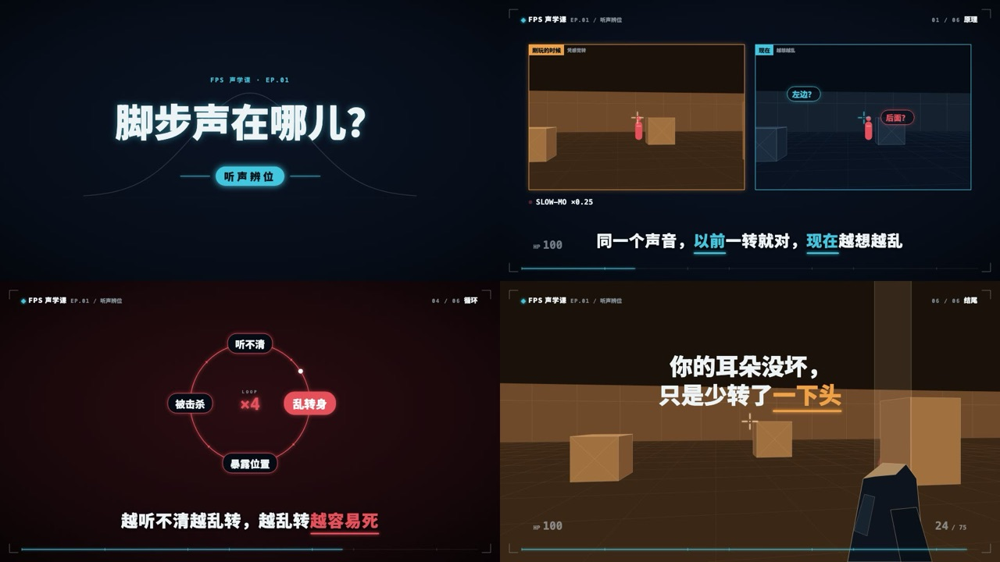
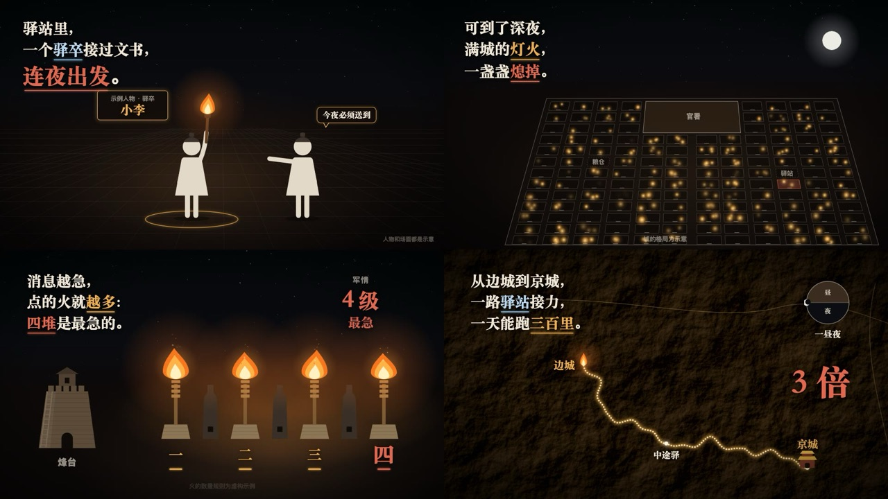
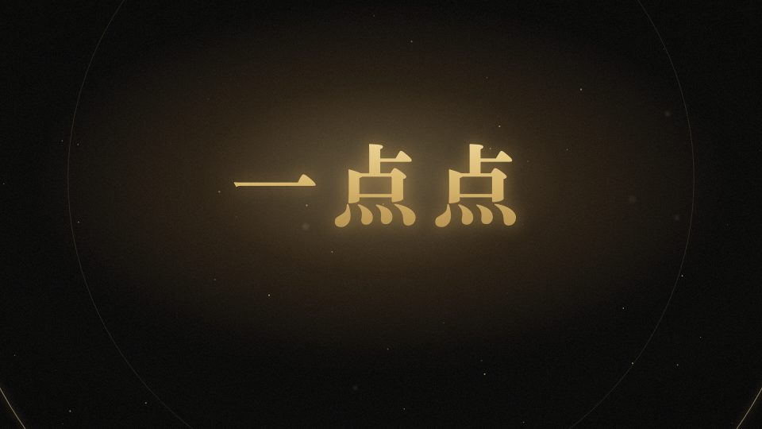
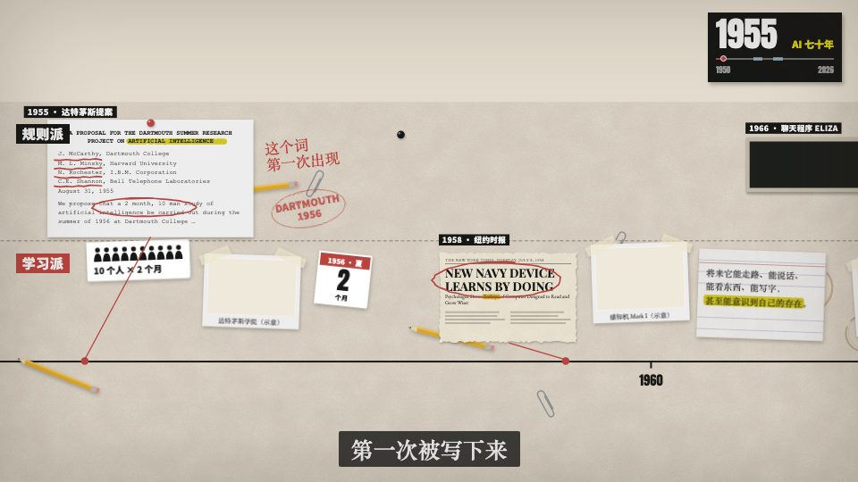
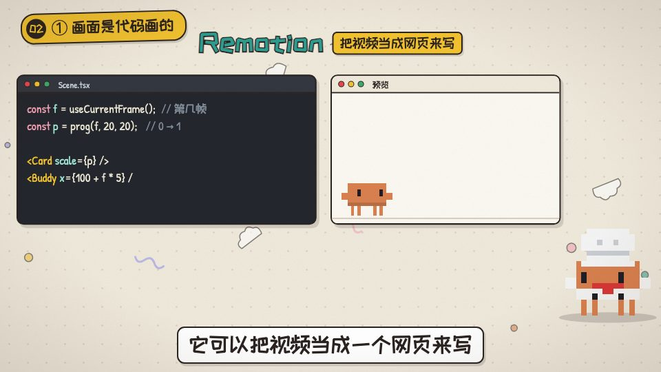

<h1 align="center">weilanx-claude-videos</h1>

<p align="center">
  
</p>

<p align="center"><strong>全部用代码写出来的知识短视频，外加一套把选题直接变成成片的 Claude Code Skill。</strong></p>
<p align="center">Remotion + React + SVG 画面，程序化合成的音效，动画对齐到字幕或配乐的拍子上。先从参考视频蒸馏风格，再一锅出做一期。</p>

<p align="center">
  <a href="./LICENSE"></a>
  <a href="https://github.com/Azure12355/weilanx-claude-videos/stargazers"></a>
  <a href="https://github.com/Azure12355/weilanx-claude-videos/commits"></a>
</p>

<p align="center">
  <a href="./README.md">English</a> · <strong>简体中文</strong>
</p>

<p align="center">
  
  
</p>

## 目录

- [概述](#概述)
- [风格一览](#风格一览)
- [特性](#特性)
- [快速开始](#快速开始)
- [工作流 Skill](#工作流-skill)
- [怎么用这些 Skill](#怎么用这些-skill)
- [仓库里没有的内容](#仓库里没有的内容)
- [做新一期](#做新一期)
- [项目结构](#项目结构)
- [Agent 快速上手](#agent-快速上手)
- [许可证](#许可证)

## 概述

weilanx-claude-videos 是一个 Remotion 工程，用来做讲 AI、科技史、科学、博弈论、FPS 游戏和中国古代知识的短视频（以中文为主）。画面不是在编辑器里画的：角色、道具、背景、图表、字幕和音效都由代码生成。口播期数需要一段录音和它的字幕，无口播期数只需要一首配乐。

仓库包含可复用的组件库（8 套风格素材包）、风格库、音频合成流水线、八个 Claude Code 工作流 Skill，以及 50 多期视频的完整源码，可以直接当示例看。

## 风格一览

下面每一帧都是本仓库的代码渲染出来的。每种风格在 [`styles/我的风格/`](styles/README.md) 有配方卡，在 `src/library/` 有可复用的组件。

### 已在用的风格

<table>
  <tr>
    <td width="50%" align="center"><br><b>黑金光影风</b> · 16:9 · 无口播<br><sub>近黑底暖色烟雾，金粒子聚成标题，霓虹收益矩阵，聚光灯下的发光小人，中英字幕。组件：<code>src/library/blackgold/</code> · Skill：<code>blackgold-video</code> · 样片：<code>ep36</code></sub></td>
    <td width="50%" align="center"><br><b>战术屏科普风</b> · 16:9 · 无口播<br><sub>游戏 HUD 框，低多边形 3D 射击场重演那一刻，发光图表，红屏裂纹死亡。组件：<code>src/library/tactical/</code> · Skill：<code>fps-video</code> · 样片：<code>ep25</code>–<code>ep51</code></sub></td>
  </tr>
  <tr>
    <td align="center"><br><b>灯火史话风</b> · 16:9 · 无口播<br><sub>暖黑夜色、火光、象形小人，透视城市逐格亮灯，纸卷律文。组件：<code>src/library/lamplight/</code> · Skill：<code>lamplight-video</code> · 样片：<code>ep28</code>、<code>ep30</code>、<code>ep34</code>、<code>ep41</code>、<code>ep46</code></sub></td>
    <td align="center"><br><b>暖纸工作台风</b> · 16:9 · 口播<br><sub>暖米色点阵纸、白色窗口卡片、步骤条，像素吉祥物常驻，可加真人出镜小窗。组件：<code>src/library/warm-desk/</code> · Skill：<code>desk-video</code> · 样片：<code>ep26</code>、<code>ep27</code></sub></td>
  </tr>
  <tr>
    <td align="center"><br><b>网点档案风</b> · 16:9<br><sub>米白旧纸或藏青夜色 + 渐变网点，粗宋大字带错版投影，印章砸下。组件：<code>src/library/halftone/</code> · 预览：<code>library-halftone</code></sub></td>
    <td align="center"><br><b>协作剪辑台风</b> · 16:9<br><sub>软件界面一镜到底：左侧群聊、中间画布、几何小角色在时间轴上拖片段。组件：<code>src/library/editor-room/</code> · 预览：<code>library-editor-room</code></sub></td>
  </tr>
  <tr>
    <td width="50%" align="center"><br><b>暗金文献风</b> · 16:9<br><sub>近黑底、金线图表、衬线字，年份抬头和文献印章。组件：<code>src/library/gilded/</code> · 预览：<code>library-gilded</code></sub></td>
    <td width="50%" align="center"><br><b>暗金文献风 · 纯音乐知识短片</b> · 16:9<br><sub>无口播：中英字幕，锚词踩在配乐重拍上砸出来。样片：<code>ep23-wheat-chessboard</code></sub></td>
  </tr>
  <tr>
    <td align="center"><br><b>Vox 时间轴长卷</b> · 16:9<br><sub>旧纸桌面上一条时间尺和两条泳道，剪报和网点照片钉在年份上。样片：<code>ep18</code>–<code>ep20</code></sub></td>
    <td align="center"><br><b>Vox 硬切拼贴</b> · 16:9<br><sub>A-roll 黑卡大字，B-roll 是钉在桌面上的真实素材（素材不在仓库里），按字幕硬切。样片：<code>ep21</code>、<code>ep22</code></sub></td>
  </tr>
  <tr>
    <td align="center"><br><b>像素手绘风</b> · 16:9<br><sub>像素主持人 + 细线手绘卡片，演播室 A-roll + B-roll。样片：<code>ep03</code>、<code>ep04</code></sub></td>
    <td align="center"><br><b>矢量手绘风</b><br><sub>带嘴巴和配饰的矢量小人，手绘剪辑软件界面。样片：<code>ep00-demo</code>–<code>ep02</code></sub></td>
  </tr>
  <tr>
    <td align="center"><br><b>像素贴纸风</b> · 竖屏 3:4<br><sub>像素小人 + 贴纸风大字（白边硬投影）+ 漂浮涂鸦背景。样片：<code>ep05</code>–<code>ep17</code></sub></td>
    <td></td>
  </tr>
</table>

### 35 种艺术风格

从洞穴岩画到蒸汽波，35 种艺术风格的配方卡和场景代码，每种都有预览，见 [`styles/艺术风格/`](styles/README.md)。它们跑在 [huashu-art-motion](https://github.com/alchaincyf/huashu-art-motion)（MIT）的 Canvas 引擎上，可以改写成 Remotion 组件。


### 9 种解说语法

解说视频的画面语法（3Blue1Brown 式数学动画、Kurzgesagt 式插画、白板、发布会、财经图表、Vox、Storytime、动态文字、讲解员），附语法卡和示范代码，见 [`styles/解说语法/`](styles/README.md)。


## 特性

- **帧号纯函数动画**：每个组件都由帧号算出这一帧的样子；随机用带种子的 `rand(seed)`，渲染结果完全确定。
- **字幕驱动时间轴**：`makeCues` 把 SRT 变成 `cf(n)`（第 n 句开始帧）、`cw(n, '词')`（说到某个词的帧）。重录口播后重新导入字幕，所有动画自动重新对齐。
- **角色库**：矢量或像素风小人（`Char`），支持皮肤、配饰、表情、走路和伸手动画，通过 `CharStyle` Context 切换画风。
- **多种画风**：黑金光影风、战术屏科普风、灯火史话风、暖纸工作台风、暗金文献风、网点档案风、协作剪辑台风、像素贴纸风、像素手绘风、矢量手绘风，以及 Vox 拼贴 / 时间轴套件，见[风格一览](#风格一览)。
- **卡拍子的无口播短片**：每期一个 `timeline.ts`，装着小节网格、重拍帧、中英字幕、镜头和音效；高潮落在配乐实测的重拍上。
- **一锅出工作流 Skill**：从选题一路做到导出的成片、封面、发布文案和字幕稿，自带抽帧和响度自查。
- **程序化音频**：14 个合成音效，每期配乐会按人声自动闪避。
- **音乐库**：`audio/music.mjs` 从 `public/music/` 里的曲子截一段、淡入淡出、统一响度；纯音乐短片的高潮对齐实测的配乐重拍。
- **干净导出**：人声 / 配乐 / 音效分轨渲染，再经限幅重新混音，避开 Remotion 内部混音削波。
- **风格库**：35 种艺术风格和 9 种解说语法（配方和场景代码），做新一期前先挑风格。

## 快速开始

需要 Node.js（开发时用 v24），导出需要 `ffmpeg`。

```sh
git clone https://github.com/Azure12355/weilanx-claude-videos.git
cd weilanx-claude-videos
npm install
npm run audio      # 生成共享音效和 ep00 demo 配乐到 public/audio/
npm run studio     # 打开 Remotion Studio：http://localhost:3000
```

建议先打开 `ep00-demo`：它是独立的 30 秒 demo，不依赖任何外部素材。

其他常用命令：

```sh
npm test                       # vitest
npm run typecheck              # tsc --noUnusedLocals
npx remotion still src/index.ts ep06-context out.jpg --frame=200 --scale=0.4   # 渲染单帧
npm run export -- ep00-demo    # 导出到 bash scripts/ep-dir.sh ep00-demo out 打印的目录
```

> `npm run audio` 遇到缺人声或缺配乐的期数会报错（见[仓库里没有的内容](#仓库里没有的内容)），共享音效和 ep00 配乐照常生成。只想生成某一期的音频，跑 `node audio/episodes/<作品ID>.mjs`。

## 工作流 Skill

`.claude/skills/` 里有八个 Claude Code Skill。用 Claude Code 打开工程，直接说你想做什么，对应的 Skill 会自动被调用。

| Skill | 作用 | 交付方式 | 样片 |
|---|---|---|---|
| `weilanx-creator-distill-video` | 把参考视频逐镜头拆解（硬切、关键帧、色板、动效切片、卡点），蒸馏出画面语法，写成 `src/library/` 下一套新的风格素材包，附预览作品和配方卡 | 素材包 + 预览 + 配方卡 | `gilded/`、`tactical/`、`lamplight/`、`blackgold/` |
| `weilanx-creator-blackgold-video` | 黑金光影风知识短片：讲博弈论或一个反直觉模型，无口播、中英字幕 | **一锅出**：成片、3:4 封面、发布文案、双语字幕稿 | `ep36` |
| `weilanx-creator-fps-video` | 战术屏科普风：讲 FPS 游戏里某个挫败瞬间背后的原理，无口播 | **一锅出**：成片、3:4 封面、发布文案、字幕稿 | `ep25`、`ep29`… |
| `weilanx-creator-lamplight-video` | 灯火史话风：讲一条中国古代制度或冷知识，无口播 | 先出文案与卡点稿，确认后一口气出片 | `ep28`、`ep30`… |
| `weilanx-creator-gilded-video` | 暗金文献风纯音乐知识短片：锚词、高潮踩在实测的配乐重拍上 | Studio 预览，确认后导出 | `ep23`、`ep24` |
| `weilanx-creator-desk-video` | 暖纸工作台风口播：「我是怎么用 AI 做 XX 的」「一件事分几步」这类流程拆解 | Studio 预览，确认后导出 | `ep26`、`ep27` |
| `weilanx-creator-vox-video` | Vox 拼贴风科普：查资料、找有授权的真实素材、带语气的配音、按字幕硬切 | Studio 预览，确认后导出 | `ep21` |
| `weilanx-creator-pixel-video` | 一个关键词 → 一期像素风口播动画（竖屏 3:4） | Studio 预览，确认后导出 | `ep05`–`ep17` |

Skill 自带的脚本：`analyze.py`、`strip.py`（视频拆解）、`beats.py`（测 BPM、小节网格和重拍）、`qa.mjs`（一锅出 Skill 的自动抽帧和响度自查）、字幕稿生成脚本、`commons.py`（搜 Wikimedia Commons 并查授权）。

有些步骤原本用的是作者的私人工具（复刻音色、语音识别、文生图封面、标题公式库）。每个 Skill 里都有一节 **依赖（开源版说明）**，写明换成什么；黑金光影风的一锅出流程除了配乐，不依赖任何私人工具。

## 怎么用这些 Skill

### 准备

- Node.js（开发时用 v24），已经 `npm install`
- `ffmpeg`：导出和测响度
- [`uv`](https://docs.astral.sh/uv/)：跑 Python 辅助脚本（用法是 `uv run --with numpy --with pillow python …`）
- 在仓库根目录打开 [Claude Code](https://claude.com/claude-code)，它会读 `CLAUDE.md` → `AGENTS.md` 和 `.claude/skills/` 里的 Skill
- 字体：新风格用的是系统中文字体（macOS 的 `Songti SC`、`PingFang SC`，回落到 `Noto Serif SC` / `Noto Sans SC`），在 macOS 上效果最好

### 从参考视频蒸馏一套风格

原则是 **风格一比一，内容不搬**：组件全部重写，示例内容自己编，原片的帧、字幕、标题、水印一样不进仓库。

1. 把一支或几支参考视频放进 `template/`（已在 `.gitignore` 里，那是别人的作品）。
2. 在 Claude Code 里说：「把 `template/参考.mp4` 的风格蒸馏成一套新素材」。
3. Skill 先对每支视频做机器拆解（镜头表、关键帧、联系表、主色板和强调色、运动强度、配乐卡点），报告写到 `materials/00-公共/风格蒸馏/<风格ID>/`。
4. 再在关键时刻切动效切片，写 `styles/我的风格/<中文名>/` 的配方卡，写出 `src/library/<风格ID>/` 素材包和 `library-<风格ID>` 预览作品，并登记进 `src/library/README.md` 和 `styles/README.md`。
5. 交付前至少对照原片自查两轮。在 Studio 打开 `http://localhost:3000/library-<风格ID>` 看效果。

拆解也可以手动跑：

```sh
uv run --with numpy --with pillow python .claude/skills/weilanx-creator-distill-video/scripts/analyze.py \
  template/参考.mp4 --out materials/00-公共/风格蒸馏/<风格ID>/<视频名>
```

### 一锅出做一期

一锅出 Skill（`blackgold`、`fps`）拿到选题后一路做到交付，中途不停下来等确认：查一手资料 → 定锚词和分镜 → 写卡在配乐拍子上的 `timeline.ts` → 合成音效 → 画面 → 测试 → 自动抽帧、测响度、自己修（最多三轮）→ 导出 → 3:4 封面、发布文案和字幕稿。

1. **准备配乐。** 样片都卡在 `we-never` 上，这是作者已获授权的自用曲目，mp3 不随仓库分发。把你自己有授权的曲子放进 `public/music/`，在 `audio/music.mjs` 的 `TRACKS` 登记，然后测拍子：

   ```sh
   uv run --with numpy python .claude/skills/weilanx-creator-gilded-video/scripts/beats.py public/music/<曲子>.mp3 --to 40
   ```

   再把这一期 `timeline.ts` 的网格和重拍帧对到实测结果上（告诉 Skill 用哪首曲子，它会自己改）。
2. **给一个选题**，比如「做一期黑金风的，讲智猪博弈」或者「做一期 FPS 科普：为什么我总是对枪先死」。选题要明确给出：作者的选题池在 `materials/` 里，没有放进仓库。
3. Skill 会取下一个期号，用 `scripts/ep-dir.sh` 建好素材目录和成片目录，并从样片代码改起（黑金风照 `ep36-boxed-pigs`，FPS 照战术屏最近一期），不从空白写。
4. 交付物在成片目录（`bash scripts/ep-dir.sh <作品ID> out`）：`<作品ID>.mp4`、`封面-3x4.png`、`发布文案.md`、`字幕稿.md`，黑金风另有 `字幕.srt`。

黑金风的封面由代码渲染（`CoverTall.tsx`）；FPS 的封面用文生图模型生成，可以换成任何出图工具，或者直接渲一帧当封面。

## 仓库里没有的内容

为了保护作者隐私和第三方版权，以下内容**有意没有**放进仓库：

| 路径 | 原本是什么 | 影响 |
|---|---|---|
| `public/audio/<期>/voice.wav` | 原始口播录音 | 口播期数在 Studio 里没有人声，也无法生成配乐 |
| `public/footage/<期>/` | 真实照片和视频片段、真人出镜录像 | ep03、ep07、ep21、ep22、ep26、ep27 中这些面板为空 |
| `public/images/ep04-opus55/` | ep04 用到的截图 | ep04 的图片面板为空 |
| `public/music/*.mp3` | 音乐库的曲子（只带了目录 `public/music/README.md`）。ep23 起所有无口播期数用的 `we-never` 是作者已获授权的自用曲目，不再分发 | 无口播期数没有声音，配乐脚本会报错，换上你自己有授权的曲子即可 |
| `template/` | 蒸馏风格用的参考视频（别人的作品） | — |
| `materials/`、`out/` | 原始录音、文稿、选题池、拆解报告、成片 | 由 `scripts/ep-dir.sh` 按需创建 |

每一期的画面代码、字幕、时间表和场景源码都保留了，可以研究、改用，也可以换上自己的人声和配乐。

## 做新一期

优先用[工作流 Skill](#怎么用这些-skill)。手动做一期口播视频的步骤：

1. 建目录：`bash scripts/ep-dir.sh epXX-主题 materials --new <风格目录> <中文短题>`，把口播转成 SRT 字幕放进去。
2. 人声标准化到约 −16 LUFS，存为 `public/audio/epXX-主题/voice.wav`（48 kHz、立体声、16-bit）。
3. 导入字幕：`npm run cues -- <素材目录>/字幕.srt src/episodes/epXX-主题/cues.json`。
4. 新建 `audio/episodes/epXX-主题.mjs`（配乐段落表），运行 `node audio/episodes/epXX-主题.mjs`。
5. 新建 `src/episodes/epXX-主题/`，竖屏参考 `ep02-llm`、横屏参考 `ep03-cc`；在 `src/Root.tsx` 注册，并加 `tests/episodes/epXX-主题.test.ts`。
6. 用 `npx remotion still` 抽帧检查，在 Studio 里预览，再 `npm run export -- epXX-主题`。

无口播期数不用字幕驱动，而是每期一个 `timeline.ts`，见黑金、战术屏、灯火、暗金四个 Skill。

## 项目结构

| 路径 | 用途 |
|---|---|
| `src/library/` | 可复用组件：`Show` 骨架、字幕工具、角色、道具、场景，以及每种风格一套素材包：`blackgold/`、`tactical/`、`lamplight/`、`warm-desk/`、`gilded/`、`halftone/`、`editor-room/`、`vox/`（[目录](src/library/README.md)） |
| `src/episodes/` | 每期一个目录；口播期数基于 `Show`，无口播期数用自己的 `timeline.ts` |
| `src/Root.tsx` | 注册所有作品 |
| `audio/` | 音效合成、配乐引擎、音乐库（`music.mjs`）、每期配乐段落表 |
| `scripts/` | 字幕导入、导出、分轨混音，以及按风格管理 `materials/`、`out/` 目录的 `ep-dir.sh` |
| `styles/` | 风格库（[总表](styles/README.md)） |
| `.claude/skills/` | Claude Code 工作流 Skill（[见上文](#工作流-skill)） |
| `tests/` | 素材库和每期的测试 |
| `public/fonts/` | 随仓库分发的 OFL 字体（[许可](public/fonts/LICENSES.md)） |

## Agent 快速上手

### 目标

做出确定性的口播动画：每个画面都是帧号的纯函数，并且锚定在字幕时间上。不做通用视频编辑器，也不托管作者的录音和素材。

### 权威来源

- 工程约定和流水线：[`AGENTS.md`](AGENTS.md)
- 组件目录：[`src/library/README.md`](src/library/README.md)
- 作品注册：`src/Root.tsx`
- 测试：`tests/`

### 安全工作流

1. 先读 `AGENTS.md` 和素材库 README。
2. 修改场景或素材库组件；`src/library/` 不能 import `src/episodes/`。
3. 运行 `npm test` 和 `npm run typecheck`。
4. 用 `npx remotion still ... --scale=0.4` 检查画面，不要为检查渲染整片。

### 命令

```sh
npm install
npm test
npm run typecheck
npm run studio
```

### 边界

- 不提交录音、成片、真实素材、音乐文件、参考视频、`.env` 文件或密钥。
- 组件里不用 `Math.random()`、CSS 动画或真实时间。
- 只引入允许再分发的第三方素材，并记录来源。

## 许可证

代码以 [MIT 许可证](LICENSE) 发布。

第三方内容：

- `public/fonts/` 中的字体采用 SIL Open Font License 1.1，见 [`public/fonts/LICENSES.md`](public/fonts/LICENSES.md)。其他风格引用的是系统字体，没有随仓库分发。
- 仓库不带任何音乐。无口播样片用到的 `we-never` 是作者已获授权的自用曲目，不在这里再分发，请换成你自己有授权的曲子。
- 从参考视频蒸馏出的风格只借用画面语法（配色、版式、动效、节奏），组件和示例内容都是原创，参考视频的帧、字幕和水印都没有收录。
- `styles/` 中的艺术风格和解说语法改编自 [alchaincyf/huashu-art-motion](https://github.com/alchaincyf/huashu-art-motion)（MIT），见 [`styles/LICENSE-huashu-art-motion`](styles/LICENSE-huashu-art-motion)。
- 视频里出现的产品名称和标志归各自所有者，仅用于评论和讲解。
