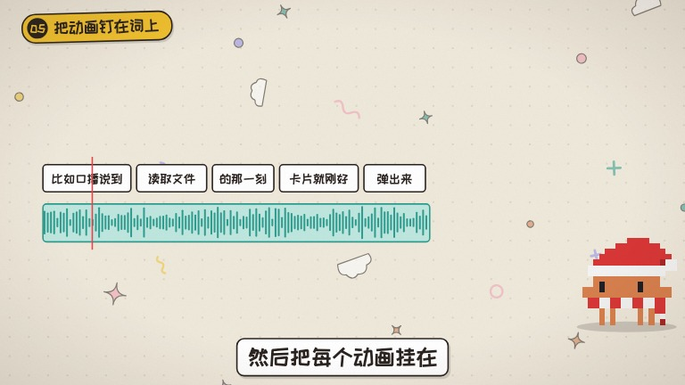

# 像素手绘风

像素小人配细线手绘卡片，横屏 16:9，是从矢量手绘风过渡到像素贴纸风的中间版本。

## 画面特征

- 角色已经换成像素风：`<CharStyle.Provider value="pixel">`
- 卡片和大字还是 `classic` 手绘细线（没开 `look: 'sticker'`）
- 横屏演播室 `Host` 做 A-roll，B-roll 主持人 `PiP` 站右下角；ep04 加入了真实图片素材（`Photo`）

## 期数

| 期数 | 主题 |
|---|---|
| ep03-cc | 用 CC 做动画视频 |
| ep04-opus55 | Opus 5.5（含真人录音和图片素材） |
