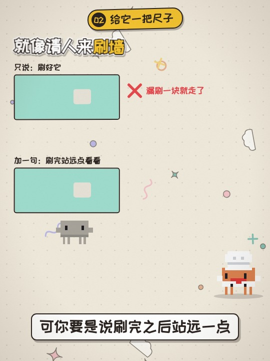

# 像素贴纸风

ep05 起的主力风格，目前所有新一期都用它。

## 画面特征

- 只有 CC 和 AI 小人是像素风：`<CharStyle.Provider value="pixel">`，皮肤只用 `headphones` `santa` `cowboy` `chef` `detective`，CC 没有嘴
- 字体、卡片、背景都是手绘贴纸风：`look: 'sticker'`，大字描边加粗、白边加硬投影，`Pop` 出来的元素会轻轻晃
- 背景用 `DoodlePaper`（点阵纸加慢慢漂浮的小涂鸦）
- ep06 起竖屏 3:4（1080×1440），舞台 1080×1080，首帧放封面；A-roll 用 `HostTall` 演播室，B-roll 主持人 `PiP` 站右下角

## 关键代码

- 骨架：`src/library/Show.tsx`（`look: 'sticker'`、`cover`）
- 角色：`src/library/character/PixelBuddy.tsx`、`Char.tsx`
- 演播室：`src/library/sets/Studio.tsx`
- 配置示例：`src/episodes/ep17-sycophancy/Ep17Sycophancy.tsx`

## 期数

| 期数 | 主题 | 画幅 |
|---|---|---|
| ep05-token | token 是什么 | 横屏 |
| ep06-context | 上下文 | 横屏 + 竖屏 |
| ep07-agent | Agent 是什么 | 横屏 + 竖屏 |
| ep08-hallucination | AI 幻觉 | 横屏 + 竖屏 |
| ep09-prompt | 提示词 | 竖屏 3:4 |
| ep10-multimodal | 多模态 | 竖屏 3:4 |
| ep11-mcp | MCP | 竖屏 3:4 |
| ep12-skill | Skill | 竖屏 3:4 |
| ep13-subagent | 子 Agent | 竖屏 3:4 |
| ep14-agent-permission | Agent 权限 | 竖屏 3:4 |
| ep15-prompt-injection | 提示词注入 | 竖屏 3:4 |
| ep16-agent-done | Agent 说做完了其实没做完 | 竖屏 3:4 |
| ep17-sycophancy | AI 总说你说得对 | 竖屏 3:4 |
