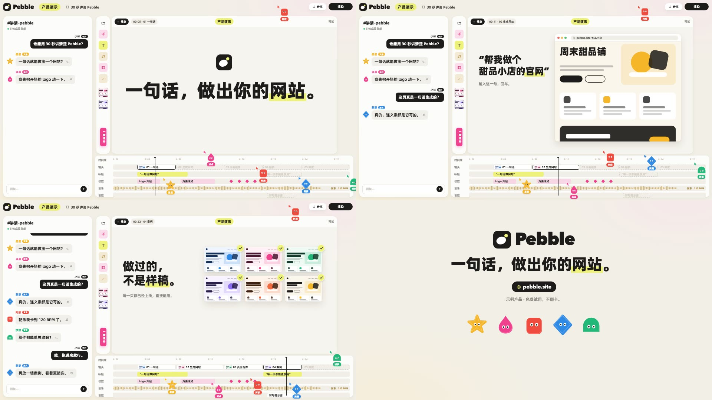

# 协作剪辑台风

把一个产品（网站、App、工具）的演示**装进一个「多人在线剪辑软件」的界面里**讲：左边是团队群聊，几个彩色几何小角色你一言我一语地抛问题；中间画布在「播放」概念演示（大标题、网站页面、功能卡）；底部时间轴上，小角色当协作者光标，把一个个镜头片段拖进轨道、播放头一直往前走；最后整屏切成 logo 收尾卡。一镜到底、没有硬切，节奏靠聊天冒泡、片段落轨和画布换内容推进。适合 30～60 秒的网站 / 产品宣传动画、功能发布、SaaS 落地页演示。

画面语法从一支 41 秒的 4K 产品宣传片里拆出来（拆解包在 `materials/00-公共/风格蒸馏/editor-room/`，不进 git），组件和示例全部重写：原片的品牌名、logo、文案、吉祥物造型、第三方产品图都没有带进来。

## 画面特征

- **底色与质感**：暖米白 `#f2efe6` 平涂，四角带极淡的暖光渐晕（左下偏黄、右上偏粉）；白色面板 `#fcfcfc` 圆角 18～20、无描边、极淡的投影；画布底是更暖一点的 `#f6f4ee`。整片亮、饱和度极低（平均饱和度 0.06），没有颗粒和纸纹，干净的「软件截图」质感。
- **配色**：90% 是米白和白，墨黑 `#1d1c1a` 只用在大标题、深色胶囊按钮（播放、渲染、用户自己的聊天气泡）；强调色只占 3%：
  - **荧光黄绿** `#eef17a`：唯一的「重点」色——顶栏标签、画布标题胶囊、标题里关键词底下的荧光笔、高亮的功能按钮、渲染进度条；
  - **五个小角色的颜色**：琥珀、品红、珊瑚红、天蓝、翠绿，每个角色一种，名字、身份标签、光标都用自己的颜色；
  - **时间轴**：音乐轨是金棕色波形 `#c9a24e`，动效轨是浅粉色块 + 品红关键帧菱形。
- **字体**：中文大标题用很粗的黑体（略带一点斜感的 Heavy 体），英文 / 产品名用几何无衬线粗体；界面文字是普通黑体 500～700；时间码和刻度用等宽字。标题字号很大（画布宽度的 40～60%），界面字很小（14～20px），对比强烈。
- **固定版式**（1920×1080）：
  - 顶栏 y 0～70：左上产品 logo + 名字、荧光黄「概念演示」胶囊、项目标题；右上「分享」白胶囊 + 黑色「渲染」大胶囊（结尾时从左往右被荧光黄填满，表示渲染进度）。
  - 左栏 x 18～495：群聊面板。顶部「#频道名 · N 位成员在线」，下面消息流：别人的消息在左边（彩色角色头像 + 彩色名字 + 彩色身份小标签 + 浅灰气泡 + 一个小图标），「我」的消息在右边（黑色气泡白字，名字旁黑色身份标签）；底部输入框 + 黑色圆形发送键。消息多了整列往上滚。
  - 工具条 x 520～590：一列圆角方块按钮（粉、黄、米色底的线性图标），下面两张小缩略图，一根竖着的品红胶囊标签。
  - 画布 x 600～1815：顶部一行「▶ 播放」黑胶囊 + 时间码胶囊「00:10 · 镜头名」+ 居中荧光黄标签 + 右侧灰色「预览」；中间是演示内容。
  - 时间轴 x 512～1905、y 835～1063：左列轨道名（时间线 / 镜头 / 标题 / 动效 / 音乐 / 音效），上方刻度，黑色细竖线播放头，各轨片段是圆角浅色块。
- **小角色**：五个纯色几何小怪（原片是五边形、圆团、六边形、三角、圆角方块，我们换成**星星、水滴、胶囊、菱形、半圆拱**），两个白色小眼睛，没有嘴；它们同时是聊天头像和时间轴上的「协作者光标」——头顶一个同色鼠标箭头，脚下一个同色名字胶囊，原地轻轻上下浮动，偶尔飞到顶栏上空。
- **出场方式**（实测）：
  - 文字按短语出现：每个短语从浅灰半透明淡入成黑色、同时上移约 10px，6 帧左右；短语之间隔 4～8 帧；
  - 关键词底下的荧光笔从左往右扫过，约 6 帧，压在字的下半截；
  - 胶囊、小卡片从下方 20px 淡入浮上来；功能按钮一个接一个弹出（带一点回弹）；
  - 聊天消息：气泡淡入 + 轻微放大，同时整列上滚一格；
  - 镜头片段落轨：小角色把片段从上方拖下来，占位的虚线框变成带缩略图的实心片段。
- **转场**：整支片子一镜到底，界面不动；**画布里的内容硬切**（换一个镜头，时间码胶囊里的镜头名跟着换）；结尾整个界面淡出，切到纯米白的 logo 收尾卡。
- **镜头**：固定机位，不推不摇（偶尔画布里的网页自己滚动）。
- **节奏**：约 120 BPM 的轻快电子配乐；聊天消息、画布换镜头、片段落轨大致卡在小节上；播放头匀速走。
- **招牌画面**：多人协作光标在时间轴上拖片段；黑白聊天气泡一问一答；大标题 + 荧光笔关键词；功能卡旁边弹出一列「指令 / 资源 / 可复用」小胶囊；一屏网站缩略图墙，每张打一个荧光黄对勾贴纸；收尾卡「logo + 一句口号（关键词荧光笔）+ 黑色网址胶囊 + 一排小角色」。

## 组件

| 文件 | 组件 |
|---|---|
| `src/library/editor-room/theme.ts` | 配色 `E`、字体 `EF`、`pop` 短语淡入上浮、`hl` 荧光笔进度、`bob` 小角色浮动 |
| `src/library/editor-room/mascots.tsx` | `Critter` 五个原创几何小角色（星 / 滴 / 胶囊 / 菱 / 拱，`blink` 眨眼）、`CursorCritter` 协作者光标（箭头 + 角色 + 名字胶囊）、`CREW` 默认五人组 |
| `src/library/editor-room/stage.tsx` | `RoomBg` 暖米白底、`TopBar` 顶栏（logo、标签、分享、渲染进度）、`ChatPanel` 群聊（消息按帧冒出、自动上滚）、`ToolRail` 工具条、`CanvasPanel` 画布（播放胶囊、时间码、标签）、`Timeline` 时间轴（轨道、片段落轨、播放头、波形、关键帧、协作者光标）、`EditorRoom` 整套界面 |
| `src/library/editor-room/canvas.tsx` | 画布内容：`PopTitle` 短语逐个浮现的大标题（`〔词〕` 荧光笔）、`BrowserMock` 浏览器窗口 + 原创网站示意页（可滚动）、`FeatureCard` 功能卡 + 侧边弹出胶囊、`ThumbWall` 页面缩略图墙 + 对勾贴纸、`LogoTiles` 兼容 / 集成卡片行、`EndCard` 收尾卡、`BrandMark` 原创示例 logo |

## 关键代码

- 素材库：`src/library/editor-room/`（目录见 `src/library/README.md`「协作剪辑台风」一节）
- 预览：Studio 里的 `library-editor-room`（`src/library/previews/EditorRoomDemo.tsx`），示例产品是虚构的建站工具「Pebble」

## 期数

| 期 | 内容 | 画幅 |
|---|---|---|
| 还未使用 | | |

## 没有搬的东西

- 原片的产品名、logo、口号、网址、聊天文案、镜头名，以及原片演示的第三方产品名和网页截图；示例换成虚构的建站工具「Pebble」，文案自己写。
- 原片五个小角色的造型（五边形、圆团、六边形、三角、圆角方块）不用；我们的小角色是另外五种几何形（星星、水滴、胶囊、菱形、半圆拱），眼睛画法也不同。
- 原片的配乐不进素材包；要配乐走音乐库，授权单独确认。
