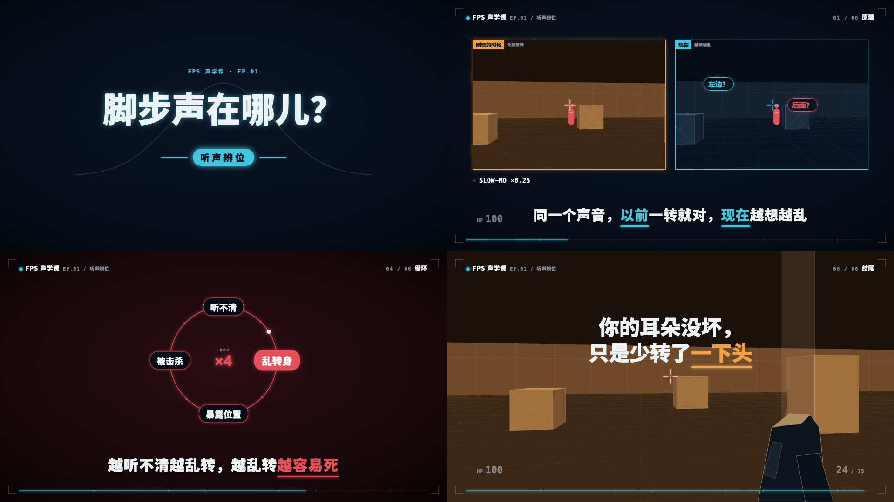

# 战术屏科普风

把一个 FPS 里的挫败瞬间，用科学模型拆开讲：深蓝黑的游戏 HUD 框里，低多边形 3D 射击场「重演」那一刻，发光图表给出模型，大字卡给结论。适合 2 分钟左右、分 6～7 章的游戏科普（无畏契约等战术射击）。画面语法是从参考视频里拆出来的（参考视频不进 git），组件和示例都是重写的，没有沿用原片的内容、文案、系列名和角色。爆款结构和选题见 [爆款解析.md](爆款解析.md)。做新一期用 `weilanx-creator-fps-video` 技能（样片 ep25）。

## 画面特征

- **底色与质感**：深蓝黑 `#050b14` → `#0b1323` 径向渐变，极淡的 60px 网格，四周压暗；没有颗粒和纸纹，干净的「屏幕」质感。
- **配色**：底色深蓝黑；青 `#42c6df`（你 / 正确 / 主线）、红 `#e5505b`（敌人 / 失误 / 变差）、橙 `#f0a045`（高手 / 答案 / 以前）、绿 `#3ecf8e`（变好 / 新上限）。图表线都带同色外发光。
- **字体**：中文全用黑体 Heavy（思源黑体 900）；编号、HP、弹药、刻度、系列标用等宽粗体（Menlo Bold），字距拉开。
- **固定版式**：四角 L 形细角标（内缩 36px、边长 34px）；左上「◆ 系列名 EP.xx / 本期关键词」；右上「03 / 07 章节名」；底部一条青色进度条，带章节刻度；3D 场景时左下「HP 100」、右下「25 / 75」。字幕在 y≈910，白色 64px 粗黑体。开场前 17 秒 HUD 下方（y≈100–200）挂一条 `HookBanner` 常驻标题（第二人称痛点问句，问题部分标红），到第一个爆点前收暗时退场。
- **出场方式**：标题和字幕逐字从模糊里浮出（每字约 2 帧，模糊 10px → 0）；关键词变色并在下方长出 6px 的发光短横；图表线一笔画出（约 20–30 帧），数据点、标签随后弹出；元素淡入为主，不弹跳。
- **转场**：镜头之间硬切；死亡用「命中火花 → 整屏红色 + 中心放射裂纹」；揭晓答案用「黑场 → 白闪 → 橙色大字 + 同心圆环」。
- **镜头**：3D 场景里相机缓慢平移或慢放（左上「● SLOW-MO ×0.25」），图表静止；两个画面需要比较时左右分屏，各自加青 / 橙色边框和标题。
- **节奏**：138 秒约 20–34 个镜头，平均 4～6 秒；每章右上章节号跳一格，进度条走一段。
- **招牌画面**：暖橙「以前」vs 冷青「现在」的同一个射击场；钟形曲线上抽样一个点；50 发子弹的散布 + 命中率；循环环（胶囊节点 + 中间 LOOP ×n）；红屏裂纹死亡。

## 组件

| 文件 | 组件 |
|---|---|
| `src/library/tactical/theme.ts` | 配色 `T`、字体 `TF`、`glow` 发光、`typeChar` 逐字浮现、`drawLen` 描线进度 |
| `src/library/tactical/stage.tsx` | `TacBg` 背景、`HudFrame` HUD 框（角标、系列标、章节号、进度条、HP / 弹药）、`TitleCard` 标题卡、`TCaption` 字幕（`【】`青 `〖〗`红 `〔〕`橙）、`BigWord` 大字卡、`Strike` 划掉重写、`DeathScreen` 红屏裂纹、`AnswerReveal` 揭晓、`SlowMo` 慢放标、`Bubble` 疑问胶囊、`SplitPanel` 分屏框 |
| `src/library/tactical/range.tsx` | `Range` 低多边形 3D 射击场（相机、地面网格、墙板、箱子、人靶，`tone` 冷青 / 暖橙 / 红）、`Crosshair` 准星、`ViewGun` 原创枪模（后坐）、`Tracer` 弹道、`HitMark` 命中 / HEADSHOT、`TopMap` 俯视图（掩体、视野三角、视线） |
| `src/library/tactical/charts.tsx` | `NeonLine` 发光折线、`BellCurve` 钟形曲线、`Spread` 散布 + 命中率、`TradeoffCurve` 速度—准确率曲线、`LoopRing` 循环环、`MsBars` 毫秒条、`Gauge` 表盘、`RankGem` 段位晶石、`ScatterAvg` 散点 + 平均线 |

## 关键代码

- 素材库：`src/library/tactical/`（目录见 `src/library/README.md`「战术屏科普风」一节）
- 预览：Studio 里的 `library-tactical`（`src/library/previews/TacticalDemo.tsx`）

## 对照自查记录

- 第一轮：毫秒条的「ms」被挤到第二行 → 加宽并禁止换行；速度—准确率曲线画反了（低速时高手低于你）→ 改成整条曲线向右平移，高手处处更准；子弹散布太小 → 放大 1.35 倍。
- 第二轮（和原片同类画面左右对照）：循环环胶囊和字号偏小 → 字号 28→38；散布人形从实心改为描边、头部竖带改虚线；曲线标签重叠 → 标在 mark 点旁；字幕 60→64px。
- 动效对照：标题和字幕逐字模糊浮现（每字 2 帧）、折线逐段画出且尾段变红、死亡红屏 5 帧染红 + 裂纹、揭晓「黑场 8 帧 → 白闪 → 橙字 + 圆环」，和原片切片一致。

## 没有搬的东西

- 原片的系列名、期号、文案、字幕、题目和分镜顺序都没用；示例换了题目（脚步声为什么听不出前后），文案自己写。
- 游戏的角色、地图、枪械模型、logo 一律不画：人靶是原创的胶囊人，枪模是原创的低多边形块，射击场是通用的方块场景。提到《无畏契约》只用文字，不放官方素材。
- 原片配乐不进素材包；它是 112～115 BPM 的电子乐，换成音乐库或合成配乐。

## 期数

| 期 | 内容 | 画幅 |
|---|---|---|
| ep25-behind-cover | 躲进掩体，为什么还被打死？（约 2 分 18 秒，无口播；配乐 we-never，标题砸在 17.45 秒重拍、锚词「过去」砸在 102.52 秒；事实出自 Riot 技术博客） | 横屏 16:9 |
| ep29-footsteps | 听得到脚步，分不清前后？（EP.02，约 2 分 18 秒，无口播；锚词「对称」砸在 102.52 秒；混淆锥、耳廓 HRTF、转头破对称；事实出自 Riot 补丁说明 2.06 和 JASA / Frontiers 论文；新增 `hearing.tsx` 听觉示意图和脚步声音效） | 横屏 16:9 |
| ep31-rigged | 系统是不是故意让我输？（EP.03，约 2 分 18 秒，无口播；锚词「公平」砸在 102.52 秒；隐藏分天梯、每局五五开、100 把里 5 连跪 81%、坏事比好事重；事实出自 Riot《Ask VALORANT – Rank Rating Edition》、Phroxzon 2025 开发者视频、Baumeister 2001；新增 `ranked.tsx` 排位示意图） | 横屏 16:9 |
| ep33-teammates | 为什么总匹配到坑队友？（EP.04，约 2 分 18 秒，无口播；锚词「坑队友」砸在 102.52 秒；五人里最差的 80% 是队友、两边的坑一半一半、观战只看得到队友失误、自利归因偏差 d = 0.96、小号和分差；事实出自 Riot 2020 竞技模式说明、Phroxzon 2025、Mezulis 2004；`ranked.tsx` 新增 `TeamRow`） | 横屏 16:9 |
| ep35-choke | 一到残局，手就开始抖？（EP.05，约 2 分 18 秒，无口播，不做下期预告；锚词「自动驾驶」砸在 102.52 秒；程序化技能、压力让人盯着自己的动作、推杆 vs 字母算术、被盯着练能消除失常、外部焦点；事实出自 Baumeister 1984、Beilock & Carr 2001、Wulf 2013） | 横屏 16:9 |
| ep37-bhop | 连跳为什么越跳越快？（EP.06，约 2 分 18 秒，无口播；锚词「影子」砸在 102.52 秒；地面摩擦、空中限速 30 只量投影、斜边累加、每帧转角、TF2 的 1.2 倍上限；事实出自 Quake 源码（GPL）和 Valve Source SDK 2013；新增 `vectors.tsx` 向量 / 投影 / 速度表 / 源码卡） | 横屏 16:9 |
| ep39-latency | 帧数翻倍，反应变快了吗？（EP.07，约 2 分 18 秒，无口播；锚词「流水线」砸在 102.52 秒；系统延迟五段、渲染队列排队、一帧 8.3 → 4.2 ms、刷新率与延迟拆开测、12 vs 20 ms 差 182 ms；事实出自 NVIDIA《Introducing NVIDIA Reflex》2020 和 Spjut 等 2019（SIGGRAPH Asia）；新增 `pipeline.tsx` 流水线 / 泳道 / 延迟堆叠条） | 横屏 16:9 |
| ep40-counter-strafe | 跑着开枪，怎么总打不中？（EP.08，约 2 分 18 秒，无口播；「技巧 × 原理」第一期，技巧 = 点一下反方向键急停；锚词「刹车」砸在 102.52 秒；跑动误差、27.5% 死区、松手只靠摩擦 0.31 秒、反向推力 0.06 秒快 5 倍、按住会反向窗口 0.05 秒；事实出自 Riot《VALORANT Patch Notes 3.0》2021 和 Valve《Source SDK 2013》；新增 `movement.tsx` 速度曲线 / 散布靶） | 横屏 16:9 |
| ep42-tap-fire | 扫射压不住，点射更准？（EP.09，约 2 分 18 秒，无口播；技巧 = 按距离换打法、远处点射停顿；锚词「停顿」砸在 102.52 秒；散布圈连发变大、恢复时间 0.375 秒、命中率 =（头 ÷ 圈）²、远一倍 → 1/4、近处扫远处点；事实出自 Riot《VALORANT Patch Notes 0.50》2020、Valve CS:GO 博客《Recovery Time》2015 /《Second Shot》2016；新增 `spread.tsx` 散布圈 / 热度曲线 / 面积题 / 分组命中率条） | 横屏 16:9 |
| ep43-one-more-game | 输了还想再来一把？（EP.10，约 2 分 18 秒，无口播；第一期「冤 → 翻案 → 招」+ 开场常驻标题条；锚词「差一点」砸在 102.52 秒；老虎机实验、差一点更难受却更想玩、奖赏回路像赢了一样亮、自己选才有效、30% 最勾人；事实出自 Clark 等 2009（Neuron）和 Kassinove & Schare 2001；新增 `reward.tsx` 转轮 / 脑图 / 再来一局按钮 / 比分条） | 横屏 16:9 |
| ep45-callouts | 队友报点，你怎么听不见？（EP.11，约 2 分 18 秒，无口播；冤 → 翻案 → 招 + 开场常驻标题条；锚词「带宽」砸在 102.52 秒；十字只闪 150 ms、21/24 vs 5/24 听见、约 100 ms 听觉反应被压低、82% → 45%、在等也漏、超过 31% 警报没被察觉；事实出自 Macdonald & Lavie 2011、Molloy 等 2015（J Neurosci）、Raveh & Lavie 2015、Giraudet 等 2015（PLoS ONE）；新增 `attention.tsx` 语音条 / 注意力带宽 / 十字刺激 / 人头点阵 / 诱发曲线 / 波形） | 横屏 16:9 |
| ep47-spotlight | 旁边有人，你怎么没看见？（EP.12，约 2 分 18 秒，无口播；ep45 的视觉姊妹篇，冤 → 翻案 → 招 + 开场常驻标题条；锚词「聚光灯」砸在 102.52 秒；大猩猩走过 5 秒、96 人 56% 没看见、简单 64% / 困难 45%、离目标近 61% 远 64%、知道也漏 11% / 16%；事实出自 Simons & Chabris 1999、Cartwright-Finch & Lavie 2007、Macdonald & Lavie 2008、Simons 2010；`attention.tsx` 新增聚光灯遮罩 / 传球场 / 比例条） | 横屏 16:9 |
| ep48-jiggle-peek | 探头就跑，你怎么打不到？（EP.13，约 2 分 18 秒，无口播；冤 → 翻案 → 招 + 开场常驻标题条；锚词「窗口」砸在 102.52 秒；最快反应 213 ms（察觉 131 ms）、Riot 先手 141 / 71 ms、自己算 284–354 / 约 370–440 ms、高手靠预判；事实出自 Riot 2020、Woods 等 2015、Mann 等 2007、Correa 等 2006；新增 `window.tsx` 时间窗泳道 / 反应测试屏） | 横屏 16:9 |
| ep49-ad-strafe | 对面一横跳，你就打不中？（EP.14，约 2 分 18 秒，无口播；ep48 之后的「对枪两连」第二期；锚词「预测」砸在 102.52 秒；约 100 ms 视觉—运动延迟、匀速时预测性追踪抵消延迟、换向后手慢慢转、节奏可预期才能提前减速、拦截潜伏期 120–420 ms、死区 27.5% → 只有换向那一下停得下来开枪；事实出自 Miyamoto 等 2025、Kowler 等 2019、Engel & Soechting 2000、Engel 等 2000、de Hemptinne 等 2010、Riot Patch Notes 3.0；新增 `tracking.tsx` 关键帧 / 预测准星 / 位置—时间轨迹 / 拐弯轨迹 / 速度门槛带） | 横屏 16:9 |
| ep50-late-night | 凌晨打排位，手感去哪了？（EP.15，约 2 分 18 秒，无口播；原题「熬夜越打越菜」和对标的「越玩越菜」太像，改写；锚词「离线」砸在 102.52 秒；醒 17–19 小时 ≈ 0.05% BAC、反应最多慢 50%、每晚 6 小时 × 14 天 ≈ 两晚不睡且自己没察觉、走神 g = 0.776、超过约 16 小时断线越来越多、睡一晚动作快 20%；事实出自 Williamson & Feyer 2000、Van Dongen 等 2003、Lim & Dinges 2010、Walker 等 2002（都只读到摘要）；新增 `sleep.tsx` 24 小时清醒表盘 / 断线条） | 横屏 16:9 |
| ep51-practice | 天天练枪，怎么还不涨？（EP.16，约 2 分 18 秒，无口播；锚词「间隔」砸在 102.52 秒；练习时成绩 ≠ 学到、两种错位、外科随机对照（集中 vs 每周，一个月后分散组更好）、317 个实验、睡一晚 +20%、连着看觉得更有效但穿插考得更好；事实出自 Soderstrom & Bjork 2015、Moulton 等 2006、Cepeda 等 2006、Kornell & Bjork 2008、Walker 等 2002（都只读到摘要）；新增 `practice.tsx` 靶场点靶网格 / 练习排布条；开场用点靶「嘀」声代替枪声，避开配乐 1.4–3.4 秒的响区） | 横屏 16:9 |
