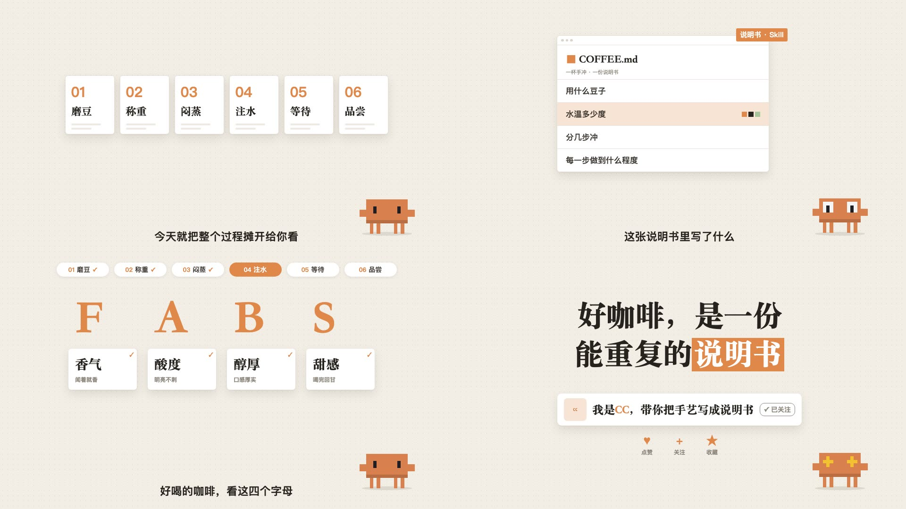

# 暖纸工作台风

一张暖米色的点阵纸就是整支片子的「工作台」：右下角常驻一个像素小人当吉祥物，白色窗口卡片、步骤条、表格、代码、选项一层层摆上来又收走，标题是粗黑体 + 一块橙色高亮。适合 3～4 分钟的口播流程拆解（「我是怎么用 AI 做 XX 的」「一件事分几步」）。做新一期用 `weilanx-creator-desk-video` 技能（口播骨架 `DeskShow`）。画面语法是从参考视频里拆出来的（参考视频不进 git），组件和示例都是重写的，没有沿用原片的内容、文案、吉祥物和创作者形象。

## 画面特征

- **底色与质感**：暖米色 `#f3efe7` 平涂 + 22px 极淡点阵 + 两团缓慢漂移的暖色柔光、四角轻微压暗；可选背景漂浮几何（细线圆环、十字、虚线弧）。镜头在每个场景里缓慢推近 2.5%，卡片带纸张叠层和回弹去模糊的入场。
- **配色**：几乎全是米色、白色和墨黑 `#211d19`；唯一的强调色是偏红的亮朱橙 `#f15a35`（大色块用左上亮右下深的渐变）（数字、高亮块、当前步骤、强调词），浅橙 `#fde5dc` 做行高亮底；灰 `#8b857b` 做次要字。整片饱和度很低，橙色只占 2–3%。
- **字体**：全部用阿里巴巴普惠体 3.0（Desk Sans，标题 900、字幕 800、卡片 700）；本机没装时回落思源黑体 Heavy / 苹方；代码和时间戳用 Menlo。（ep26 起从粗宋换成粗黑体，更现代）
- **固定版式**：右下角（x≈1640、y≈930）像素吉祥物常驻，随内容换表情、头顶冒像素「!」「?」「♪」；顶部 y≈40 一条步骤条（01 文案 / 02 配音 …），做完的步骤打勾、当前步骤变成橙色实心胶囊；底部 y≈1000 居中一行字幕（苹方 36px 黑字，无底条）。
- **卡片**：白色窗口卡（左上三个灰点 + 灰色路径标题「SKILL.md · v1」，圆角 12、细边、柔和长投影），列表行之间细分隔线，高亮行铺浅橙底；小标签是橙底白字的小方块；用户的话用「头像 + 白色气泡」。
- **出场方式**：元素淡入 + 上浮 16px（约 8 帧，easeOut）；成组卡片依次错开 3–4 帧；文字逐字浮现（每字 2 帧，带轻微模糊）；橙色高亮块从左往右刷出来（约 8 帧），被盖住的字变白。
- **转场**：几乎不硬切（230 秒只有 4 次）。换内容时旧元素淡出并向一侧倾斜滑走，新元素在原位长出；同一个元素换位置用平滑位移（约 12 帧），像在桌上挪卡片。
- **镜头**：固定机位，不推不摇。
- **节奏**：一句字幕一个画面变化（2–4 秒）；章节开头单独一屏大号「04 导演表」（橙色数字 + 黑色粗黑体）停 1–2 秒。
- **招牌画面**：步骤条 + 当前步变橙；白色窗口卡里一行行高亮；大号字母卡一个个变橙；结尾大标题「……最大的〔红利〕」式的橙块高亮 + 关注卡。

## 组件

| 文件 | 组件 |
|---|---|
| `src/library/warm-desk/theme.ts` | 配色 `D`、橙色渐变 `OG`、字体 `DF`（阿里巴巴普惠体 Desk Sans）、`rise` 回弹去模糊上浮、`slide` 平滑换位、`typeIn` 逐字升起、`wipe` 高亮刷入、`drift` 漂浮 |
| `src/library/warm-desk/stage.tsx` | `DeskBg` 点阵纸（柔光晕）、`DeskDecor` 漂浮几何、`Sparkle` 星光迸发、`Tick` 对勾、`StepBar` 步骤条、`ChapterTitle` 章节大标题（描边大编号 + PART 胶囊 + 进度点）、`Headline` 粗黑体标题（`kicker` 眉标、`〔词〕` 橙块高亮）、`DCaption` 字幕、`WindowCard` 窗口卡（`stack` 叠纸、`accent` 角标）、`Tag` 橙色小标签、`SayBubble` 头像气泡、`Leave` 倾斜滑走容器、`Rise` 淡入上浮容器 |
| `src/library/warm-desk/props.tsx` | `ListCard` 清单卡（逐行高亮、色块）、`OptionCard` 选项卡、`SpeedCards` 语速卡、`CharTimeline` 逐字时间轴、`TableCard` 表格卡、`LetterCards` 字母卡、`CodeCard` 代码卡（`dark` 深色终端）、`Seesaw` 跷跷板、`ThumbGrid` 缩略图墙、`Waveform` 声波、`BigCount` 大号计数、`FollowCard` 关注卡、`Icon` 图标、`CardFan` 叠放卡片 |
| `src/library/warm-desk/motifs.tsx` | 主视觉：`Badge` 旋转徽章、`Chips` 特性卡、`LineIcon`、`IconCards` 图标大卡、`MysteryCards` 悬念卡、`FilmStrip` 胶片条、`Rings` 同心圆、`PlayerCard` 播放卡、`FlowCards` 流程卡 |
| `src/library/warm-desk/HostCam.tsx` | `HostCam` 真人出镜小窗（左下角，A-roll 大 / B-roll 小） |
| `src/library/warm-desk/DeskShow.tsx` | `DeskShow` 口播骨架（场景表、步骤条、吉祥物、字幕、三轨音频、首帧封面、`decor` 漂浮几何、`push` 场景内缓推、`overlay` 出镜小窗） |
| `src/library/warm-desk/CoverTall.tsx` | `DeskCoverTall` 3:4 封面、`DeskCoverWide` 横版首帧封面 |
| `src/library/warm-desk/mascot.tsx` | `DeskMascot` 右下角像素吉祥物（素材库自己的 `PixelBuddy`，`eyes` 表情、轻微上下浮动、`hop` 跳一下）、`PixelEmote` 像素「!」「?」「♪」「…」 |

## 关键代码

- 素材库：`src/library/warm-desk/`（目录见 `src/library/README.md`「暖纸工作台风」一节）
- 预览：Studio 里的 `library-warm-desk`（`src/library/previews/WarmDeskDemo.tsx`）

## 对照自查记录

- 第一轮：点阵太淡看不见 → 点的不透明度 0.13 → 0.24；大卡片步骤条偏小 → 加宽到 210、加高到 250 并补两条占位线；时间轴说明压线、叠放卡片和比例卡位置偏 → 挪开。
- 第二轮（和原片同类画面左右对照）：整体尺寸比原片小约 30% → 吉祥物 0.6 → 0.95 倍、顶部胶囊 150 → 222 宽 / 28 号字且编号改橙色、清单卡 640 → 860 宽 / 行字 26 → 34、字母 170 → 200 且小卡字 40 → 56、结尾标题 96 → 124、关注卡字 34 → 48、字幕 38 → 46。
- 动效对照：步骤卡依次上浮（错开 3 帧）、章节名逐字浮现（每字 3 帧）、橙块从左刷入 8 帧、旧内容倾斜滑走 10 帧，和原片切片一致。

## 没有搬的东西

- 原片的吉祥物（像素橘子）没有画，换成素材库自己的像素小人 `PixelBuddy`（CC），只学「右下角常驻 + 换表情 + 头顶像素小反应」的用法。
- 原片的文案、字幕、步骤名、表格内容、代码、创作者头像和名字、关注卡上的账号都没用；示例题目换成「一杯手冲咖啡分几步」，文案自己写。
- 原片配乐不进素材包。

## 期数

| 期数 | 内容 | 备注 |
|---|---|---|
| ep26-opus-video | Opus 5.5 做视频（开场 52 秒试片） | 第一次真人出镜：左下角小窗 A/B-roll；用户反馈「太素」后升级成朱橙 + 普惠体 + 主视觉图形，人声降到 −19 LUFS |
