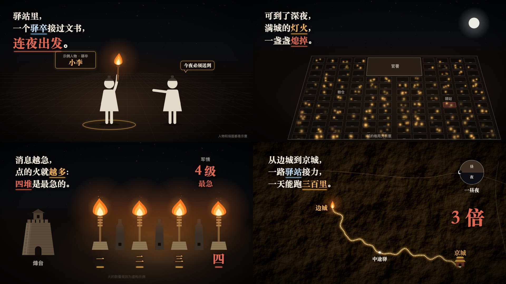

# 灯火史话风

讲古代制度、律令、城市生活这类「一条规矩背后的故事」的横屏 16:9 风格，像夜里打着火把翻一卷史书：暖黑夜色、火光、米白色象形小人，左上角一句一句写出来的宋体大字讲故事，关键词按含义上色划线。画面语法是从两支参考视频里拆出来的（参考视频不进 git），组件和示例都是重写的，没有沿用原片的内容、文案、地图和水印。

## 画面特征

- **底色与质感**：暖黑夜（中心 ≈ #2f241e，四周 #0c0908，暗角压到 #050505）；夜空段落上半屏偏冷蓝黑 #050709，撒细星点；地面一层极淡的透视网格；火把附近有一团橙色光晕（screen 叠加）和上飘的火星。地图段落用暗褐色的地形浮雕（#2a2318 左右，`feTurbulence + feDiffuseLighting` 程序生成）
- **配色**：米白（正文、小人、纸）#efe6d6；三种语义色，都只用在关键词和它对应的图形上——**冷蓝** #8fc3e8 = 名词、律文、人名（中性信息），**朱红** #e1684f = 惩罚、禁止、危险，**火金** #edae50 = 火、光、数量；纸卷 #b9a67c、木轴 #5a3a20、印章 #a8261b；说明小字灰 rgba(239,230,214,0.55)
- **字体**：叙述大字用宋体 Black（`Songti SC` 900），带一层很淡的黑色投影；标签、地名、说明小字用黑体（思源黑 Heavy / 苹方）；纸卷上的竖排字用楷 / 宋常规体
- **固定版式**：
  - 左上叙述区：x≈115，首行基线 ≈160，字号 64、行距 90，一句一行往下累加，最多 4～5 行；重点句可以跳一级到 100～110 字号
  - 右上数字区：x≈1560 居中，灰色小标签（34px 黑体）+ 宋体 Black 大数字（110px），数字从 0 滚到目标，到点时闪一颗四角星
  - 底部居中出处：26px 灰色黑体「据《某书》……；画面为示意」
  - 右下角声明：「人物和场面都是示意」
  - 需要讲朝代先后时，底部一条朝代时间轴（四个点，当前朝代放大 + 圆环）
- **出场方式**：叙述文字逐字出现：每个字从 1.25 倍、模糊 10px、灰色收拢到 1 倍清晰米白，单字 12 帧，字与字间隔约 2 帧；关键词出完后下划线从左往右画出（10 帧）。其他元素一律淡入 + 轻微模糊（15～18 帧），不弹跳
- **转场**：两种。①**暗场溶解**：旧画面 15 帧淡到暗，新画面同时淡入，能留下的元素（同一座城、同一个方块）直接贯穿不消失；②**穿光转场**：镜头朝一团火光推进放大到看不见，下一场从那团火光（地图上的一个光点）拉出来，约 18 帧。叙述区换段落时，上一段整体模糊淡出（12 帧）
- **镜头**：长镜头里缓慢推近 2～4%；地图段落镜头沿路线平移，最后扎进终点
- **节奏**：硬切极少（7 分钟 14 个），平均 10～30 秒一个「场」，靠叙述一行一行加和画面元素进出撑节奏；字幕就是画面上的叙述，没有底部字幕条
- **招牌画面**：①透视俯瞰的城市方格，一格一格亮起暖色灯火（或熄灭）；②一排火炬按数量一支支点燃，下面写「一 二 三 四」，右上角大数字同步滚动；③地形浮雕上一条发光点线路径慢慢画到终点；④木轴纸卷展开，竖排律文 + 朱红关键字 + 方印

## 组件

| 文件 | 组件 |
|---|---|
| `src/library/lamplight/theme.ts` | 配色 `L`、字体 `LF`、`charIn` 逐字收拢、`fadeSoft` 淡入、`countTo` 数字滚动、`MARK` 语义色 |
| `src/library/lamplight/stage.tsx` | `NightBg` 夜色（星空 / 地面网格 / 光晕）、`Embers` 火星、`Narration` 左上叙述（`【】`蓝 `〖〗`红 `〔〕`金 + 下划线）、`StatCorner` 右上数字、`SourceNote` 出处、`Disclaimer` 右下声明、`Glint` 四角星、`DynastyAxis` 朝代轴、`Dissolve` 暗场溶解、`DiveIn` 穿光转场、`Fade` 淡入容器 |
| `src/library/lamplight/props.tsx` | `Figure` 象形小人（站 / 举手 / 举火把 / 躺；可戴幞头）、`Torch` 火把与火焰、`Beacon` 烽燧（一排点燃）、`Watchtower` 烽台、`Gate` 坊门、`Drum` 大鼓（敲击涟漪）、`Scroll` 纸卷竖排文字 + 印、`NameTag` 金边名签、`GroundRing` 地面光圈、`TallyCard` 人数卡、`SayBubble` 金边气泡、`Moon` 月亮、`DayNightDial` 昼夜盘 |
| `src/library/lamplight/charts.tsx` | `CityGrid` 透视城市方格（逐格亮灯 / 熄灯、主城区块、标签）、`WardPlan` 俯视坊块（禁区斜纹 + 四面「禁」）、`ReliefMap` 程序地形浮雕、`GlowRoute` 发光点线路径（按进度画出、终点光点）、`Waypoint` 地图地点 |

## 关键代码

- 出片工作流：`weilanx-creator-lamplight-video` 技能（选题池、史料核对、we-never 实测硬拍、文案与卡点稿、封面与发布）

- 素材库：`src/library/lamplight/`（目录见 `src/library/README.md`「灯火史话风」一节）
- 预览：Studio 里的 `library-lamplight`（`src/library/previews/LamplightDemo.tsx`）

## 没有搬的东西

- 原片的文案、律文、诗句、史料出处、数字一律没有用；预览示例换成自己编的「古代驿站送信」题目，书名写「示例文献」
- 原片地图是真实地形图（可能有第三方数据），这里改成程序生成的假地形，不对应任何真实地点
- 原片里的城市布局、具体人物（历史人物名签）、作者水印都没有带进来；小人是按「圆头 + 梯形身 + 棍腿」的手法重画的通用象形人
- 原片配乐没有进素材包

## 期数

| 期数 | 主题 | 画幅 |
|---|---|---|
| ep28-express-relay | 「八百里加急」到底有多快？（2 分 17.5 秒，无口播，配乐 we-never；锚词「奇迹」踩 102.52 秒重拍；回落段 11 下硬拍 = 11 座驿站依次点亮） | 横屏 16:9 |
| ep30-tang-divorce | 古代女人不能离婚？（2 分 17.5 秒，无口播，配乐 we-never；锚词「一别两宽」踩 102.52 秒重拍；回落段 11 下硬拍 = 放妻书 S.343v 的 11 列依次点亮） | 横屏 16:9 |
| ep34-song-takeout | 宋朝人，已经在点外卖了（2 分 17.5 秒，无口播，配乐 we-never；锚词「银碗」踩 102.52 秒重拍；回落段 11 下硬拍 = 跑堂左手 3 碗、右臂叠 20 碗；结尾落到「信任」） | 横屏 16:9 |
| ep41-flying-money | 唐朝人，已经在异地转账了（2 分 17.5 秒，无口播，配乐 we-never；开场手机被划掉、一贯贯钱压弯扁担；锚词「交子」踩 102.52 秒重拍；回落段 11 下硬拍 = 开封交钱、券飞向 11 座州城；结尾落到「信用」） | 横屏 16:9 |
| ep46-song-ice | 宋朝人夏天，已经在喝冰饮了（2 分 17.5 秒，无口播，配乐 we-never；开场空碗第 7 拍落冰、第 8 拍白气，三把青布伞亮灯；全屏「三」= 三其凌；锚词「冬天」踩 102.52 秒重拍；回落段 11 下硬拍 = 《武林旧事》17 种凉水的水牌逐块亮；新组件 `lamplight/ice.tsx`） |
