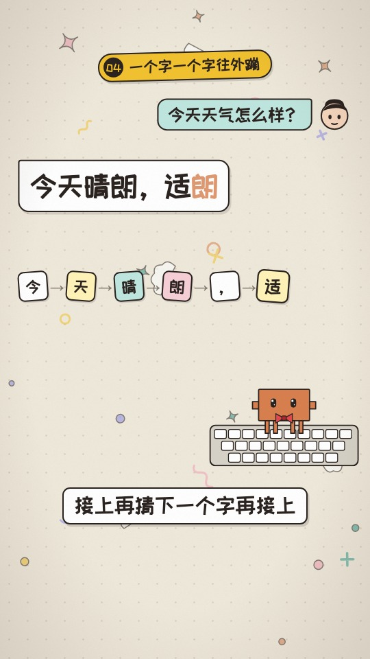

# 矢量手绘风

最早的几期，矢量手绘小人，竖屏 9:16。

## 画面特征

- 角色用 `src/library/character/BuddyFigure.tsx` 矢量小人，有嘴，可以戴配饰（`Accessories.tsx`）
- 卡片、字幕是 `classic` 手绘细线风格
- ep00 是早期 30 秒 demo，结构独立，不走 `Show`

## 期数

| 期数 | 主题 | 画幅 |
|---|---|---|
| ep00-demo | 30 秒 demo | 横屏 |
| ep01-agent | Agent 是什么 | 竖屏 9:16 |
| ep02-llm | 大模型是什么 | 竖屏 9:16 |
