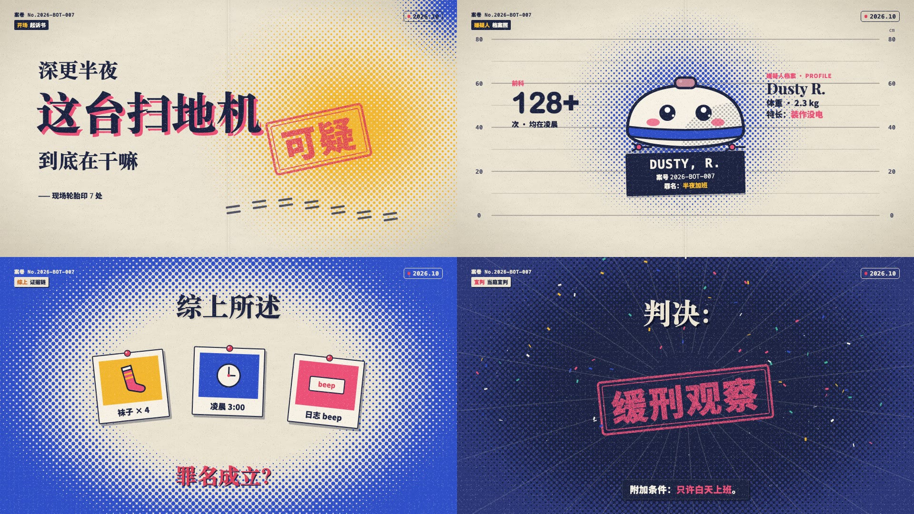

# 网点档案风

把一件小事当成「案件」来审的轻喜剧短片：米白旧纸和藏青夜色两种底，大面积渐变网点（波普印刷感），粗宋大字带粉红错版投影，左上案卷号、右上日期章，印章一砸、网点一淹就换场。适合 30～60 秒的拟人化吐槽、产品「罪状」盘点、冷知识审判。画面语法是从参考视频里拆出来的（参考视频不进 git），组件和示例都是重写的，没有沿用原片的内容、文案、角色和水印。

## 画面特征

- **底色与质感**：两种底交替。纸面 `#ece5d3`，中间有一条竖向折痕（x=50%，浅一档的细线 + 两侧阴影），四角轻微压暗；夜色 `#1e2547`，深处 `#151b36`，撒白色小星点。全片叠一层细颗粒（印刷噪点），大色块和描边边缘都是毛的。
- **网点**：45° 网格的圆点，点径从一个中心往外渐变（中心大、边缘消失，或反过来），像印刷的渐变网。纸面上用黄 / 粉 / 蓝，一场一种主网点 + 角落一小团别的颜色；夜色上用深蓝网点做暗角。实心色块内部也常填网点（大号数字、月亮、桌面）。
- **配色**：只用五色。藏青墨 `#1c2340`（字、描边、标签底）、钴蓝 `#2f4fc8`、粉红 `#ec5077`（错版投影、强调词、印章）、明黄 `#f2b62f`（网点、标签里的第一个词、强调词）、橙 `#e8873a`（角色和大号数字）。一个画面最多两种饱和色当主角。
- **字体**：标题是粗宋（宋体 Black，字重 900），带 6～8px 的粉红（纸面）或藏青（夜色）错版投影，往右下偏；西文和数字是圆胖无衬线（Arial Rounded MT Bold + 描边加粗），档案编号、日期、刻度用等宽（Menlo Bold）；字幕和标签用黑体 Heavy。
- **固定版式**：左上「案卷 No.xxxx」等宽小字 + 下面一枚深色标签（第一个词黄色或粉色，第二个词白色），每场换标签；右上一枚描边圆角日期章（红点闪 + 等宽日期）；底部居中一条藏青字幕条（粉红错版投影，重点词黄 / 粉）。
- **出场方式**：全部是**弹**，不是柔入。大字逐字从 0.3 倍弹到 1（easeOutBack，每字 5 帧、间隔 3 帧）；道具 6～8 帧缩放弹入；证据卡从上方落下带旋转；印章从 1.7 倍、半透明砸下，5 帧落定，砸下那帧画面轻抖 + 放射线 + 彩纸。
- **转场**：每场一次「网点淹没」：纯色圆点从一个角长大铺满（6 帧），停 2 帧，再从另一边缩小露出下一场（6 帧）。颜色在黄、粉、蓝之间轮换。档案照这种画面另加一次白闪（相机快门，3 帧）。
- **镜头**：几乎不动，画面靠元素弹入弹出撑起来；最多 1～2% 的慢推。
- **节奏**：30 秒 14 个镜头，平均 2.1 秒一换；章节画面 3～4 秒，过门画面 1 秒。配乐约 120 BPM，重拍落在印章和宣判上。
- **声音**：配乐约 120 BPM、轻快的拨弦 + 鼓（预览用 `audio/episodes/library-halftone.mjs` 合成，夜景段转小调，宣判前留白 2 秒）；每个弹入配 `pop`、印章配 `stamp`（对准落定帧 = 砸下起点 + 5）、证据卡配 `paper`、转场配 `whoosh`、宣判加 `confetti`。配乐压到 0.55 倍，音效 0.5～1，整片约 −18 LUFS、峰值 −2 dBFS。
- **招牌画面**：起诉书大标题 + 斜盖的印章；身高尺前的档案照 + 名牌；网点大号章节数字压在道具后面；夜色里的数码钟；三张带图钉的证据卡；最后宣判印章砸下撒彩纸。

## 组件

| 文件 | 组件 |
|---|---|
| `src/library/halftone/theme.ts` | 配色 `H`、字体 `HF`、`misprint` 错版投影、`chunky` 圆胖字加粗、`popScale` 弹入、`slamScale` 砸下、`shake` 落定抖动、`dropIn` 落下 |
| `src/library/halftone/stage.tsx` | `PaperBg` 纸面（折痕 + 暗角）、`NightBg` 夜色（星点）、`Halftone` / `halftonePath` 渐变网点、`DotPattern` 实心网点填充、`PrintGrain` 印刷颗粒、`CaseHeader` 案卷号 + 标签、`DateChip` 日期章、`Headline` 逐字弹入的粗宋大字、`CaptionBar` 字幕条、`DropLetters` 圆胖字母落下、`DotWipe` 网点淹没转场、`Flash` 白闪、`Rays` 放射线、`Confetti` 彩纸、`Pop` 弹入容器 |
| `src/library/halftone/props.tsx` | `RubberStamp` 橡皮印章、`HeightChart` 身高尺、`NamePlate` 名牌、`BigNumeral` 网点大号数字、`StatBlock` 前科式大数字、`ProfileBlock` 档案信息、`EvidenceCard` 带图钉的证据卡、`StickyNote` 便签、`DigitalClock` 数码钟、`CaseFolder` 案卷文件夹、`Bubble` 对话框、`BurstLabel` 拟声爆炸框、`DocWindow` 文档窗口、`Moon` 网点月亮、`SpeedLines` 速度线 |
| `src/library/halftone/suspect.tsx` | `Robo` 原创嫌疑人：扫地机器人（表情 `eyes`、边刷转动、`sleep`），`Sock` 袜子 |

## 关键代码

- 素材库：`src/library/halftone/`（目录见 `src/library/README.md`「网点档案风」一节）
- 预览：Studio 里的 `library-halftone`（`src/library/previews/HalftoneDemo.tsx`）

## 对照自查记录

- 第一轮：片头的黄 / 粉角落网点被夜色暗角盖住 → 改成「只画星点」叠在蓝底上；「01」大号数字看不出网点 → 底色换明黄、网点换橙、点距加大；档案照和结案场的嫌疑人偏小 → 放大到 600 / 360px。
- 第二轮：证据墙中间留白太小 → 网点暗角空心比例 0.25 → 0.42、最大点径 16px（最密处连成实色）；字幕高亮词两侧补 0.22em 空隙。
- 动效对照：字母落下（每字间隔 5 帧、9 帧落定、带回弹）、粗宋逐字弹入（间隔 3 帧）、印章 5 帧砸下、网点淹没 6 + 2 + 6 帧，和原片切片一致。

## 没有搬的东西

- 原片的文案、字幕、开场单词、案卷编号、日期都没用；示例换了题目（扫地机器人「嘟嘟」的半夜罪状），文案自己写。
- 原片的角色（一只橘猫）没有画：嫌疑人换成原创的扫地机器人，只学了「粗描边 + 平涂 + 网点阴影 + 腮红」的画法。
- 原片结尾的制作署名和水印没有搬，版式里也不留水印位置。
- 原片配乐不进素材包；要配乐走音乐库（`public/music/`），120 BPM 左右、重拍对准印章。

## 期数

还没有正式使用的期数。
